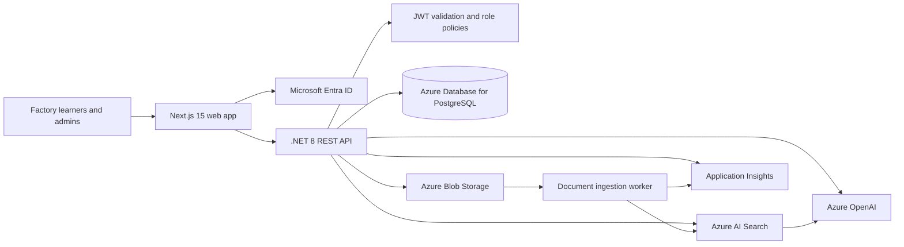
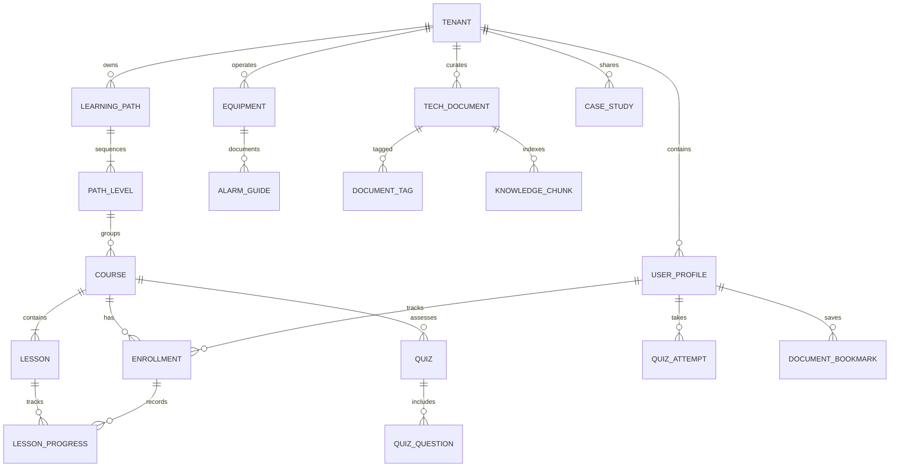

# ForgeLearn architecture

## System architecture



**Trust boundary:** Entra authenticates the user. The API authorizes tenant, plant, role and resource access on every request. Browser code must never hold database, Blob, Search or OpenAI credentials. Uploaded documents pass malware scanning and approval before indexing. RAG retrieval filters to the caller's authorized tenant/plant before any passages reach the model.

## Entity relationship diagram



## Web experience

```text
app/
  page.tsx                 dashboard
  landing/page.tsx         academy landing
  roadmap/page.tsx         five-level learning journey
  lesson/page.tsx          PLC lesson with safety, wiring reference and knowledge check
  quiz/page.tsx             locally scored quiz prototype
  library/page.tsx         searchable technical resource cards
  troubleshooting/page.tsx alarm search, filters and guide detail
  assistant/page.tsx      clearly labeled RAG assistant prototype
  admin/page.tsx          content and academy management prototype
components/                navigation, shared UI and feedback primitives
lib/data.ts                fixed demo datasets, not production persistence
backend/                   .NET Clean Architecture sample boundaries
docs/                      ERD, SQL, API, wireframes and deployment plan
```

The frontend uses Next.js App Router, TypeScript, TailwindCSS and custom accessible component primitives with a Shadcn-inspired visual language. The data in `lib/data.ts` is static and illustrative. Search, category/file-type filters, sorting, bookmarks, tabs, theme toggle and quiz scoring work locally; state resets on refresh. Authentication, API persistence, upload/download, PDF preview, quiz progress and certificates are not implemented.

## Operational architecture decisions

- Start as a modular monolith API with separate ingestion worker; split services only when scale or ownership requires it.
- Use PostgreSQL as the source of truth; Blob Storage holds original files; Azure AI Search holds derived chunks and filters.
- Carry `tenant_id` on tenant-scoped data and include it in unique keys, queries, audit events and search filters.
- Keep tenant isolation in API authorization and optionally enforce PostgreSQL row-level security as defense in depth.
- Store Entra object IDs, not passwords. Use managed identities for service-to-service Azure access.
- Use versioned, idempotent ingestion keyed by document/version; retain source page/section metadata for citations.
- Return AI answers with citations and a no-answer state. Never treat model text as approved safety instructions.
